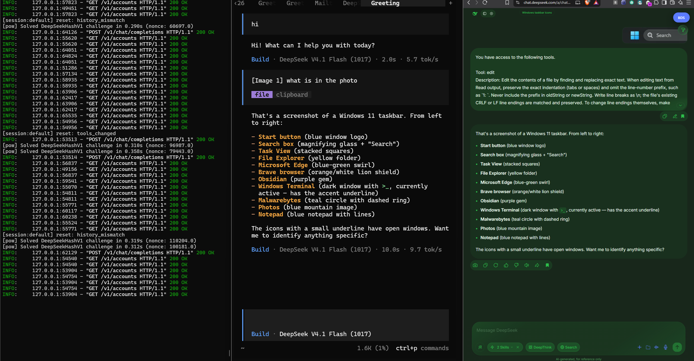

# DeepSeek Web2API v2

**Use your DeepSeek web account as a local OpenAI-compatible API.**

Runs a small FastAPI server on `http://localhost:8084` that speaks the OpenAI
`/v1/chat/completions` protocol and forwards requests to `chat.deepseek.com`
using your own logged-in session. Works with any OpenAI-compatible client
(OpenCode, Cursor, Continue, LiteLLM, the OpenAI Python/JS SDK, etc.).



> ⚠️ **Disclaimer** — This project is unofficial and not affiliated with
> DeepSeek. It relies on private web endpoints and may break at any time.
> Use it for personal experimentation only and respect DeepSeek's Terms of
> Service. Never commit your credentials.

---

## Features

- 🚀 **No API key needed** — uses your free `chat.deepseek.com` session.
- 🧠 **Thinking + Search** — exposes the web model in normal, reasoning and
  web-search variants.
- 🔐 **Built-in PoW solver** — solves DeepSeek's `DeepSeekHashV1` WebAssembly
  proof-of-work challenge automatically.
- 🔄 **True SSE streaming** — without `tools` the upstream reply is forwarded
  live, including `reasoning_content`. With `tools` the reply is buffered so
  tool-call deltas can be parsed before emission.
- 🧵 **Session reuse** — one live DeepSeek chat per agent, keyed by the
  `x-agent-session` (or `session` / `user`) header. Follow-up turns send only
  the new messages and reuse the upstream `parent_message_id`.
- 👥 **Multi-account pool** — drop several credential files in a folder and the
  server rotates between them, keeps each agent sticky to one account, honours
  `Retry-After` and cools down rate-limited or expired accounts.
- 🛡️ **Safe by default** — loopback-only bind, restricted CORS, no remote image
  fetching (SSRF-safe), optional `PROXY_API_KEY` bearer gate.
- 🛠️ **Tool calling** — the model is asked for a single JSON envelope; a
  waterfall parser (`raw_decode` → `json_repair` → `json5` → fences) recovers
  it, then retries once with self-correction and fails **loudly** with HTTP 502
  instead of leaking broken markup into `content`.
- 🖼️ **Image input** — uploads images from `image_url` parts to DeepSeek's
  vision pipeline.
- 🎛️ **Web dashboard** — paste credentials, check status and test chat at
  `http://localhost:8084`.
- 🐧 **Windows + Linux/macOS** — ships with both `.bat` and `.sh` launchers.

---

## Requirements

- **Python 3.10+**
- A DeepSeek account (https://chat.deepseek.com)
- Internet access

---

## Installation

### Windows

```bat
install.bat
start.bat
```

### Linux / macOS

```bash
chmod +x install.sh start.sh
./install.sh
./start.sh
```

### Manual (any OS)

```bash
python3 -m venv venv
source venv/bin/activate        # Windows: venv\Scripts\activate
pip install -r requirements.txt
python main.py
```

The server starts on **http://localhost:8084** and your browser is opened
automatically (harmless on headless servers).

---

## Getting your DeepSeek credentials

You only need the **`userToken`** (a JWT starting with `eyJ...`), or the full
cookie string. Both are stored locally in `config.json`, which is git-ignored
and never committed.

### Method 1 — Browser DevTools (fastest)

1. Open [chat.deepseek.com](https://chat.deepseek.com) and log in.
2. Press `F12` (or right-click → **Inspect**) to open Developer Tools.
3. Go to the **Application** tab (Chrome/Edge) or **Storage** tab (Firefox).
4. On the left, expand **Local Storage** → click `https://chat.deepseek.com`.
5. Find the key **`userToken`**, double-click its value and copy it
   (it starts with `eyJ...`).
6. Paste it into the dashboard at `http://localhost:8084` and click
   **Save & Connect**.

### Method 2 — Export cookies

1. Install a cookie export extension such as
   [cookies.txt](https://addons.mozilla.org/en-US/firefox/addon/cookies-txt/)
   (Chrome & Firefox).
2. Visit [chat.deepseek.com](https://chat.deepseek.com) while logged in.
3. Export the cookies for the site.
4. Either save them as `cookie_deepseek.txt` in the project folder, or paste
   the content into the dashboard. Both raw cookie strings and Netscape
   `cookies.txt` format are accepted.

### Method 3 — Paste anything that contains the token

The dashboard parser also accepts a bare JWT, a `Cookie:` header, a cURL dump,
or a localStorage JSON blob. It extracts `userToken` automatically.

> 🔒 **Keep it secret.** Anyone with your `userToken` can use your DeepSeek
> account. If it leaks, log out of chat.deepseek.com to invalidate it.

---

## Models

| Model ID | Description |
|---|---|
| `deepseek-ai/DeepSeek-V4.1-Flash-1017` | Fast default model |
| `deepseek-ai/DeepSeek-V4.1-Flash-1017-search` | Fast model + web search |
| `deepseek-chat` | DeepSeek V3 (fast) |
| `deepseek-search` | DeepSeek V3 + web search |
| `deepseek-reasoner` | Reasoning / thinking model |
| `deepseek-reasoner-search` | Reasoning + web search |

You can also force behaviour per request with `search_enabled` and
`thinking_enabled` boolean fields in the request body.

---

## Tool calling

When a request includes `tools`, the prompt asks the web model for exactly one
JSON object and nothing else:

```json
{"content": "<message or null>", "tool_calls": [{"name": "<tool>", "arguments": {...}}]}
```

Talk only: `{"content": "4", "tool_calls": []}` ·
Call only: `{"content": null, "tool_calls": [{"name": "bash", "arguments": {"command": "ls"}}]}`

The reply is parsed by `core/envelope.py` with a waterfall:

| Step | Handles |
|---|---|
| `json.JSONDecoder.raw_decode` | boundary-safe scan — `}`, `"`, newlines, unicode and `</tool_call>` *inside* argument values are never mistaken for structure |
| `json_repair` | trailing commas, missing quotes, truncated output |
| `json5` | single quotes, unquoted keys, comments |
| fenced blocks | ```` ```json ... ``` ```` with prose around it |
| schema validation | unknown tool name, non-object `arguments`, missing required keys → rejected |

If the model clearly attempted a tool call (markers such as `tool_calls`,
`arguments`, `dsml`, `invoke`, ` ```json `) but nothing validates, the request is
retried **once** with a correction prompt that includes the bad reply. If that
also fails, the request returns **HTTP 502** (`model attempted a tool call that
could not be parsed`) rather than putting garbage in the assistant message.

Streaming uses proper incremental deltas: one chunk with `id` + `name` +
empty `arguments` per call, then one chunk with the full `arguments` string,
then `finish_reason: "tool_calls"`. `role` is emitted exactly once and never
as `null`.

Strings are parsed with `json_repair`/`json5`, so install the two extra
dependencies (`pip install json-repair json5`) — they are already in
`requirements.txt`.

---

## Usage

### List models

```bash
curl http://localhost:8084/v1/models
```

### Chat completion

```bash
curl http://localhost:8084/v1/chat/completions \
  -H "Content-Type: application/json" \
  -d '{
    "model": "deepseek-chat",
    "messages": [{"role": "user", "content": "Hello!"}]
  }'
```

### Streaming with reasoning

```bash
curl http://localhost:8084/v1/chat/completions \
  -H "Content-Type: application/json" \
  -d '{
    "model": "deepseek-reasoner",
    "messages": [{"role": "user", "content": "How many r are in strawberry?"}],
    "stream": true
  }'
```

### OpenAI Python SDK

```python
from openai import OpenAI

client = OpenAI(
    base_url="http://localhost:8084/v1",
    api_key="sk-deepseek-local",  # any non-empty string
)

stream = client.chat.completions.create(
    model="deepseek-reasoner",
    messages=[{"role": "user", "content": "Solve: 2x + 5 = 15"}],
    stream=True,
)

for chunk in stream:
    delta = chunk.choices[0].delta
    reasoning = getattr(delta, "reasoning_content", None)
    if reasoning:
        print(reasoning, end="", flush=True)
    if delta.content:
        print(delta.content, end="", flush=True)
```

---

## Client integration

### OpenCode

Add this provider to your OpenCode config
(`~/.config/opencode/opencode.json` on Linux/macOS,
`%APPDATA%\opencode\opencode.json` on Windows):

```json
{
  "provider": {
    "deepseek-local": {
      "npm": "@ai-sdk/openai-compatible",
      "name": "DeepSeek Local",
      "options": {
        "baseURL": "http://localhost:8084/v1",
        "apiKey": "sk-deepseek-local",
        "timeout": 180000
      },
      "models": {
        "deepseek-ai/DeepSeek-V4.1-Flash-1017": {
          "name": "DeepSeek V4.1 Flash (Fast)",
          "limit": { "context": 128000, "output": 8192 }
        },
        "deepseek-ai/DeepSeek-V4.1-Flash-1017-search": {
          "name": "DeepSeek V4.1 Flash + Web Search",
          "limit": { "context": 128000, "output": 8192 }
        },
        "deepseek-reasoner": {
          "name": "DeepSeek R1 (Thinking)",
          "limit": { "context": 128000, "output": 64000 }
        },
        "deepseek-chat": {
          "name": "DeepSeek V3 (Fast)",
          "limit": { "context": 128000, "output": 8192 }
        }
      }
    }
  }
}
```

Set it as the default:

```json
{
  "model": "deepseek-local/deepseek-ai/DeepSeek-V4.1-Flash-1017",
  "small_model": "deepseek-local/deepseek-ai/DeepSeek-V4.1-Flash-1017"
}
```

### Any other client

Point it at:

- **Base URL:** `http://localhost:8084/v1`
- **API key:** any non-empty string (e.g. `sk-deepseek-local`)

### Optional: LiteLLM in front (one endpoint for every harness)

`litellm_config.yaml` is included. It does **not** parse anything — it just
forwards to this server, so `core/envelope.py` keeps doing the work:

```bash
pip install 'litellm[proxy]'
litellm --config litellm_config.yaml --port 4000
```

- opencode / Cline / Continue / Aider → `baseURL=http://localhost:4000`, model `deepseek-web`
- Claude Code → `ANTHROPIC_BASE_URL=http://localhost:4000`, `ANTHROPIC_MODEL=deepseek-web`
  (LiteLLM translates OpenAI ↔ Anthropic).

---

## Endpoints

| Method | Path | Description |
|---|---|---|
| `GET` | `/` | Dashboard UI |
| `GET` | `/health` | Liveness + account summary |
| `GET` | `/readyz` | Readiness (at least one account ready) |
| `GET` | `/api/status` | Auth status and user info |
| `POST` | `/api/cookies` | Save/validate credentials |
| `GET` | `/v1/models` | List available models |
| `POST` | `/v1/chat/completions` | Chat completion (stream or not) |
| `GET` | `/v1/sessions` | Per-agent session state |
| `POST` | `/reset-session?agent=<id>\|all` | Drop an agent's upstream chat |
| `GET` | `/v1/accounts` | Account pool state |
| `POST` | `/reload-accounts` | Re-read credential files |

---

## Sessions

Send any of these headers to pin a conversation to one agent:

```
x-agent-session: my-agent
session: my-agent
user: my-agent
```

Without a header the id is `default`.

The first request creates a DeepSeek chat and records which client messages
the remote chat has seen. Later requests send only `messages[N:]` and pass the
previous assistant `message_id` as `parent_message_id`, so the web model keeps
its own context instead of receiving the whole transcript again.

A session resets automatically when:

| Reason | Trigger |
|---|---|
| `session_ttl` | older than `DEEPSEEK_SESSION_TTL_MS` (default 2h) |
| `max_message_depth` | more than `DEEPSEEK_MAX_MESSAGE_DEPTH` turns (100) |
| `max_context_chars` | accumulated prompt+output chars over the limit |
| `tools_changed` | the request's `tools` array changed |
| `history_mismatch` | the client rewrote/compacted earlier messages |

When a reset happens, the **full conversation is resent** to the new chat, so
context is never lost — only reused when safe.

---

## Configuration

Credentials are read from `config.json` in the project root:

```json
{
  "token": "your-userToken",
  "cookie": "optional-cookie-string",
  "updated_at": 0
}
```

`config.json` and `cookie_deepseek.txt` are **git-ignored**. A safe template
lives in `config.example.json` — copy it to `config.json` and fill in your own
values, or just use the dashboard.

### Multi-account

#### In-project `accounts/` folder (default)

The repo ships with an `accounts/` folder next to `main.py`. **This is where you
put your token.** `main.py` points the pool at this folder automatically when it
exists, so no environment variable is needed:

```text
deepseek-webApi2-v1-json/
├── accounts/
│   ├── acct1.txt      ← put your token in this file
│   ├── acct2.txt      ← optional second account
│   └── ...
├── core/
├── main.py
└── ...
```

**How to add your account:**

1. Open `accounts/acct1.txt`. It currently contains the placeholder line
   `PUT_YOUR_DEEPSEEK_USERTOKEN_HERE`.
2. Replace that placeholder with your real `userToken` (a JWT starting with
   `eyJ...`) — see [Getting your DeepSeek credentials](#getting-your-deepseek-credentials).
   You can also paste a `Cookie:` header, a Netscape `cookies.txt`, or a JSON
   blob instead; `parse_credentials` extracts the token automatically.
3. Save the file. Restart the server, or call `POST /reload-accounts` to pick
   it up without a restart.
4. For more accounts, copy `acct1.txt` to `acct2.txt`, `acct3.txt`, … and put a
   different token in each. The pool rotates between them.

**What is tracked vs. secret:**

- `accounts/` and the placeholder `acct1.txt` **are tracked** in git, so a
  fresh clone already has the folder and the file to paste into.
- Every other file in `accounts/` (e.g. a filled `acct2.txt`) is **git-ignored**
  by the rules at the bottom of `.gitignore`:

  ```gitignore
  accounts/*
  !accounts/.gitkeep
  !accounts/acct1.txt
  ```

- ⚠️ Because `acct1.txt` itself is tracked, **never commit a real token in
  `acct1.txt`**. Either keep it as the placeholder and use `acct2.txt`+ for
  real tokens, or run `git update-index --skip-worktree accounts/acct1.txt` so
  your local edit is never staged.
- A filled credential file is a secret: anyone with it can use that DeepSeek
  account. Never paste one into an issue, commit, or gist.

#### Explicit paths

Point `DEEPSEEK_AUTH_DIR` at a folder of credential files, or list explicit
paths with `DEEPSEEK_AUTH_PATH` (this overrides the in-project folder):

```bash
DEEPSEEK_AUTH_DIR=C:\deepseek-accounts
# or
DEEPSEEK_AUTH_PATH=C:\a.json,C:\b.txt
```

#### Rotation behaviour

An agent stays on its account while it is healthy; when an account returns
401/403 it cools down for 30 min, and 429 / `Too many messages` uses
`Retry-After` (default 60 s). If every account is cooling, the request gets
HTTP 429 with a `Retry-After` header. Inspect the pool at `GET /v1/accounts`
or in the dashboard.

### Environment variables

| Variable | Default | Meaning |
|---|---|---|
| `PROXY_HOST` / `PROXY_PORT` | `127.0.0.1` / `8084` | Bind address |
| `PROXY_API_KEY` | unset | Require `Authorization: Bearer <key>` on all routes except `/health`/`/readyz` |
| `PROXY_CORS_ORIGINS` | unset | Extra comma-separated allowed origins |
| `DEEPSEEK_AUTH_DIR` / `DEEPSEEK_AUTH_PATH` | unset | Account pool sources |
| `DEEPSEEK_SESSION_TTL_MS` | `7200000` | Session lifetime |
| `DEEPSEEK_MAX_MESSAGE_DEPTH` | `100` | Turns before reset |
| `DEEPSEEK_MAX_PROMPT_CHARS` | `80000` | Prompt size limit |
| `DEEPSEEK_MAX_SESSION_CHARS` | `240000` | Accumulated session chars |

> The dashboard and `/api/cookies` are protected by `PROXY_API_KEY` when it is
> set. Use `curl -H "Authorization: Bearer $PROXY_API_KEY" ...` or an API
> client that sends the header.

---

## Security

- Binds to `127.0.0.1` by default; set `PROXY_HOST=0.0.0.0` only behind a
  reverse proxy, and set `PROXY_API_KEY` if you do.
- CORS allows only loopback origins plus `PROXY_CORS_ORIGINS`; credentials are
  never sent cross-origin by the proxy.
- Image input accepts **inline `data:` URIs only**. Remote URLs are never
  fetched, so this proxy cannot be used as an SSRF gadget against internal
  networks or cloud metadata endpoints.

---

## Troubleshooting

| Problem | Fix |
|---|---|
| `401 DeepSeek session not configured` | Paste your `userToken` in the dashboard. |
| `502 model attempted a tool call that could not be parsed` | The model ignored the JSON envelope twice. Retry; this is a deliberate loud failure instead of leaking broken markup. |
| `502 DeepSeek returned an empty response` | Upstream sent an empty stream (usually rate limiting). Back off and retry. |
| Process aborts with `panicked at crates/unwinder/src/stackwalk.rs` | Fixed: the WASM PoW store is now serialized. If you see it, you are running an old copy. |
| `Validation failed` | Token expired — log in again and copy a fresh one. |
| `pip install` fails on Linux | Install `python3-venv` (`sudo apt install python3-venv`). |
| `wasmtime` install error | Use Python 3.10–3.12; ensure wheels are available for your platform. |
| Browser doesn't open | Headless server — just visit the URL manually. |

---

## Concurrency notes

Parallel use works, with one caveat: the same `x-agent-session` must not be
used by two requests at the same time. Distinct agent ids are fully parallel;
the same agent id in parallel can interleave session state.

| Scenario | State |
|---|---|
| N agents, distinct ids, parallel | Works |
| N agents, same account, parallel | Works, higher upstream rate-limit risk |
| Same agent id, parallel | Not safe — session state can interleave |
| PoW under parallelism | Safe (serialized by `_SOLVER_LOCK`) |

Known unguarded spots (documented, not yet fixed):

- `server.py` `create_chat_completion()` runs an unguarded
  `plan()` → `create_chat_session()` → `mark_sent()` sequence on one
  `AgentSession`.
- `core/sessions.py` `AgentSession.mark_sent()` mutates counters and history
  without a lock.
- `core/accounts.py` `note_used()` / `mark_failure()` mutate the shared
  `Account` outside `AccountPool._lock`.

The proposed fix shape is a per-`AgentSession` lock held from `plan()` through
`mark_sent()`, and moving account mutations under the pool lock. Until then,
give each concurrent request its own `x-agent-session` value. Full review notes
live in `docs/concurrency-notes.md`.

---

## License

Provided as-is for educational and personal use. Not affiliated with DeepSeek.